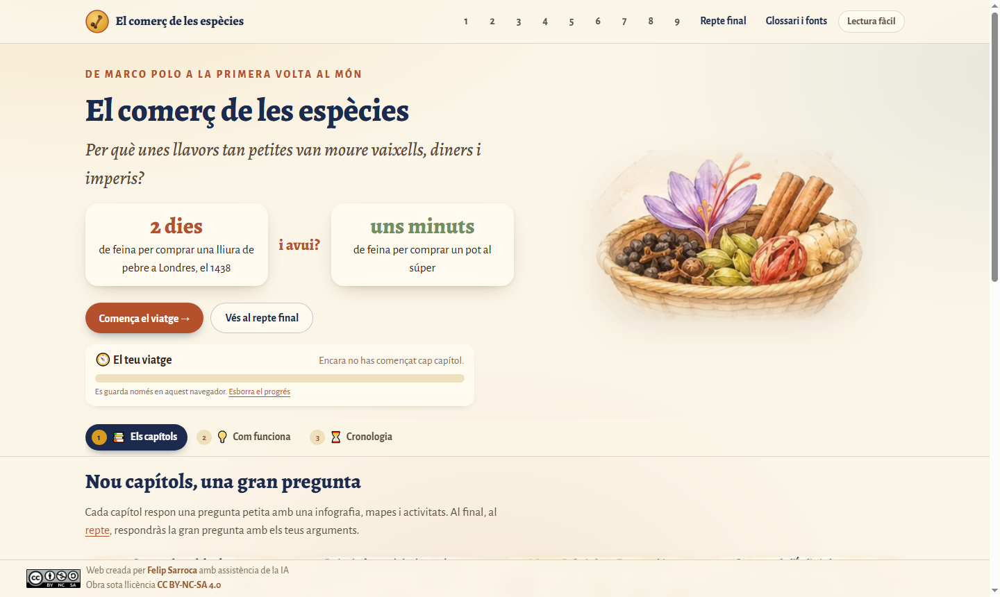
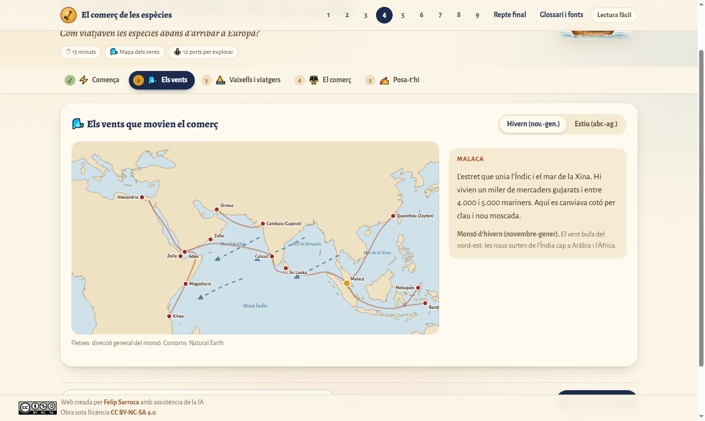
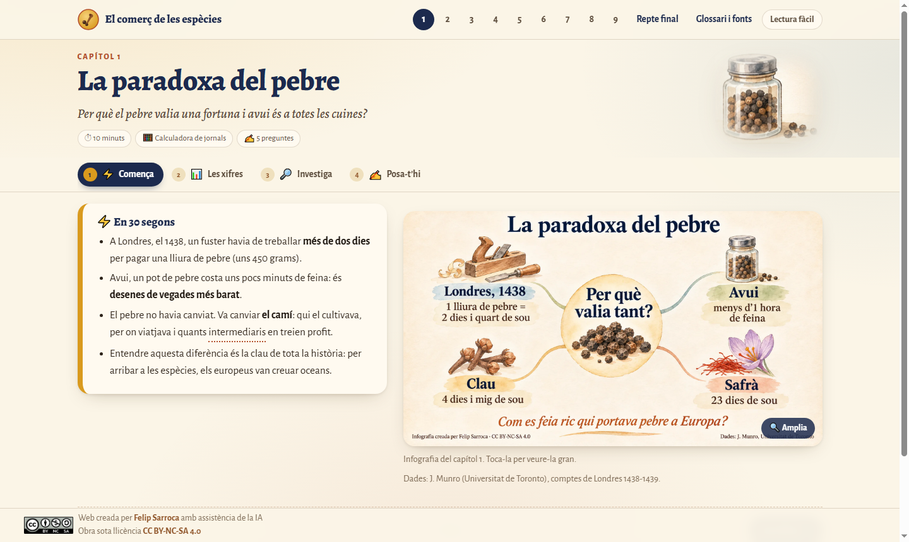
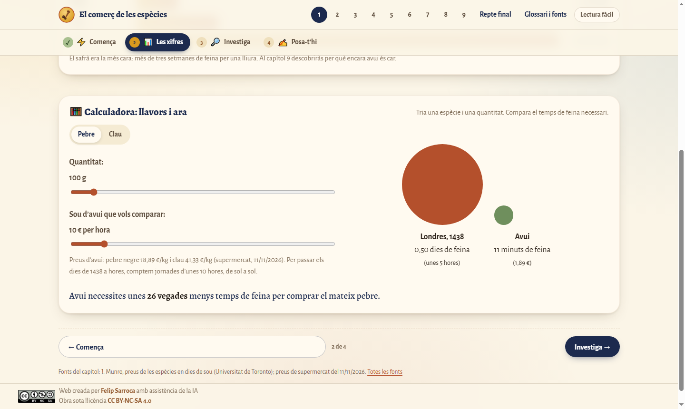
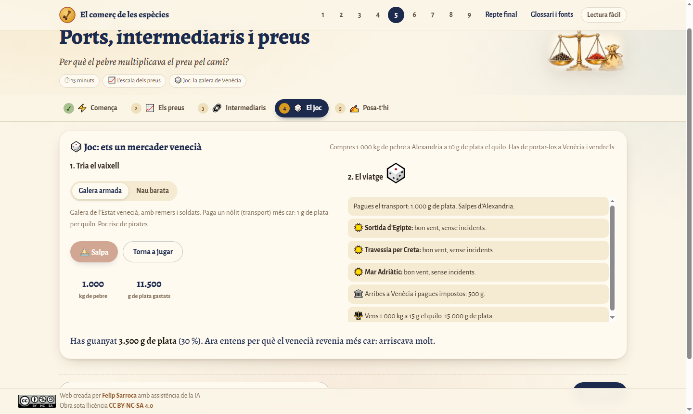
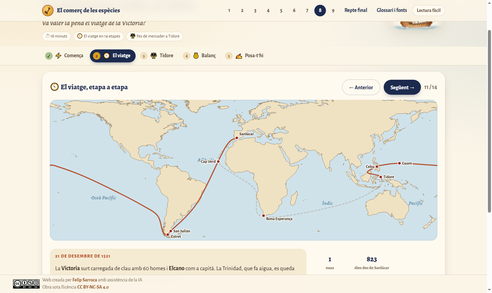
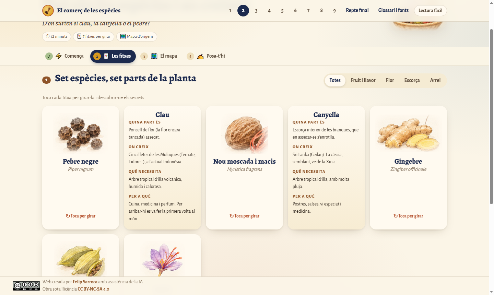
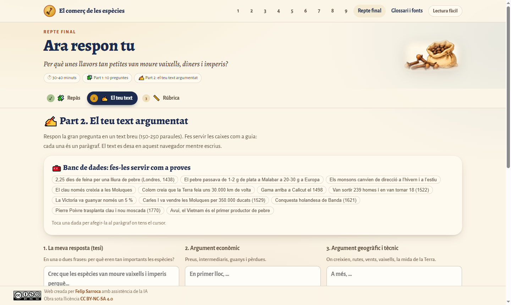
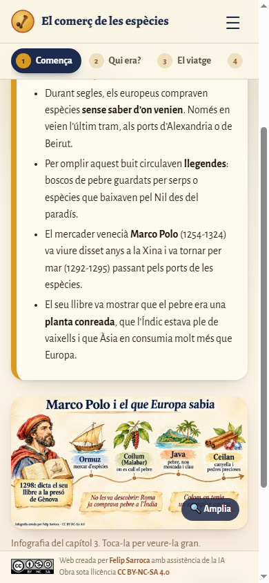

# El comerç de les espècies

> **Per què unes llavors tan petites van moure vaixells, diners i imperis?**

[](https://ja.cat/especies)
[](#com-està-fet)
[](https://creativecommons.org/licenses/by-nc-sa/4.0/deed.ca)

Web educativa en català per a l’ESO sobre el comerç de les espècies, de Marco Polo a la primera volta al món i fins avui. Nou capítols curts, cadascun amb una infografia a l’aquarel·la, mapes interactius, fonts primàries, mites desmuntats i preguntes amb correcció immediata. Al final, l’alumnat respon la gran pregunta amb un text argumentat i una rúbrica.

**[Visita la web](https://felipsarroca.github.io/web/Especies/)** · **[Enllaç curt: ja.cat/especies](https://ja.cat/especies)**



## Els nou capítols

| # | Capítol | Pregunta | Activitat estrella |
|---|---|---|---|
| 1 | La paradoxa del pebre | Per què el pebre valia una fortuna i avui és a totes les cuines? | Calculadora de jornals: Londres 1438 i avui |
| 2 | Què són les espècies i on creixen | D’on surten el clau, la canyella o el pebre? | Set fitxes que giren i mapa d’orígens |
| 3 | Marco Polo i el que Europa sabia | Què en sabien, els europeus, de l’origen de les espècies? | Viatge de tornada pas a pas i «Veritat o llegenda?» |
| 4 | La xarxa de l’Índic i els monsons | Com viatjaven les espècies abans d’arribar a Europa? | Mapa amb 14 ports i els vents d’hivern i d’estiu |
| 5 | Ports, intermediaris i preus | Per què el pebre multiplicava el preu pel camí? | Escala de preus i joc de la galera de Venècia |
| 6 | Qui les comprava a Europa | Per a què les volien i quin paper hi tenia Barcelona? | Al moll de Barcelona: entra o surt? |
| 7 | Colom i Gama: dues apostes | Per què buscar un camí nou per mar fins a les espècies? | Rutes animades, la Terra petita de Colom i els regals de Gama |
| 8 | La primera volta al món | Va valer la pena el viatge de la Victoria? | Viatge en 14 etapes i mercader a Tidore |
| 9 | Per què avui són barates | Què va canviar i les podríem plantar aquí? | Cinc segles de preus i «Es pot plantar a Catalunya?» |

A més: **repte final** (10 preguntes de repàs, text argumentat guiat amb banc de dades, còpia per a Classroom i rúbrica d’autoavaluació) i **glossari i fonts** (24 termes, fonts primàries i acadèmiques, descàrregues i orientacions per al professorat).





## Pensada per a l’aula

- **Per etapes, sense desplaçaments eterns**: cada capítol es divideix en pestanyes (Comença · activitats · Posa-t’hi) amb una barra fixa, i les preguntes es responen d’una en una com a targetes.
- **En 30 segons**: cada capítol comença amb un resum i té una versió de **lectura fàcil** per a alumnat nouvingut o amb NESE.
- **Glossari emergent**: les paraules subratllades mostren la definició en tocar-les.
- **Fonts primàries** traduïdes: Marco Polo, Pigafetta, el diari de Colom i el del viatge de Gama.
- **Mites desmuntats**: la carn podrida, el tancament otomà de 1453, la Terra plana.
- **Progrés** desat només al navegador: cada capítol fet queda marcat a la portada i al menú.
- **Encaix curricular**: Ciències Socials: Geografia i Història (Decret 175/2022), 2n i 3r d’ESO. Proposta de 6-8 sessions a la pàgina de fonts.

| | |
|---|---|
|  |  |
|  |  |
|  |  |

## Rigor

Els continguts surten del quadern de NotebookLM «El comerç de les espècies» (49 fonts): textos complets de Marco Polo, Pigafetta, Colom i Gama; estudis de Munro, Lane, O’Rourke i Williamson, Coulon i García Marsilla; World History Encyclopedia, Library of Congress i Viquipèdia. Les discrepàncies entre fonts s’han verificat (per exemple, Saragossa: 350.000 ducats, no 50.000). Les xifres aproximades s’indiquen com a tals.

## Com està fet

Web estàtica sense dependències ni compilació: HTML, CSS i JavaScript.

```
Especies/
├── index.html, paradoxa.html … avui.html, repte.html, fonts.html
├── css/estil.css          estil comú (paleta de pergamí, Alegreya)
├── js/comu.js             navegació, progrés, glossari, visor, qüestionaris, escala de pantalla
├── js/mapa.js             mapes SVG amb rutes animades
├── js/mapes-dades.js      contorns de Natural Earth (generat per eines/mapa_dades.py)
├── img/                   infografies WebP i il·lustracions retallades
├── infografies/           PNG 1920 × 1080 i PPTX per projectar; control/ amb guió, encàrrecs i revisió
└── eines/                 scripts Python per regenerar imatges i mapes
```

- **Adaptació a la pantalla**: com a `edu-apps/Equacions`, la interfície s’escala uniformement en portàtils petits (1366 × 768, mínim 80 %) i es recalcula en canviar la mida. En mòbil passa a una sola columna, sense desplaçament horitzontal.
- **Accessibilitat**: navegació amb teclat, focus visible, textos alternatius, `prefers-reduced-motion`.
- **Provar-la en local**: des de la carpeta `web`, `python -m http.server` i obrir `http://localhost:8000/Especies/`.

## Crèdits i llicència

Web creada per [Felip Sarroca](https://ja.cat/felipsarroca) amb assistència de la IA. Infografies generades amb IA a partir d’encàrrecs verificats i revisades una a una. Mapes: [Natural Earth](https://www.naturalearthdata.com/) (domini públic).

Obra sota llicència [CC BY-NC-SA 4.0](https://creativecommons.org/licenses/by-nc-sa/4.0/deed.ca).
