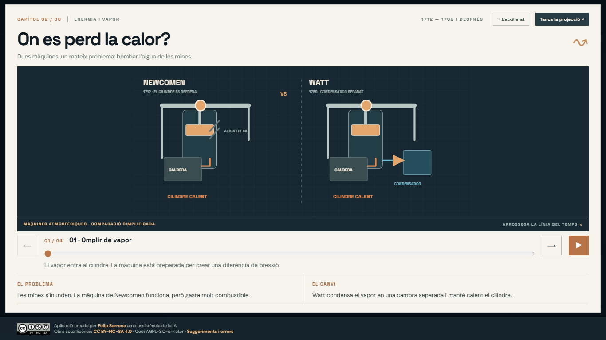
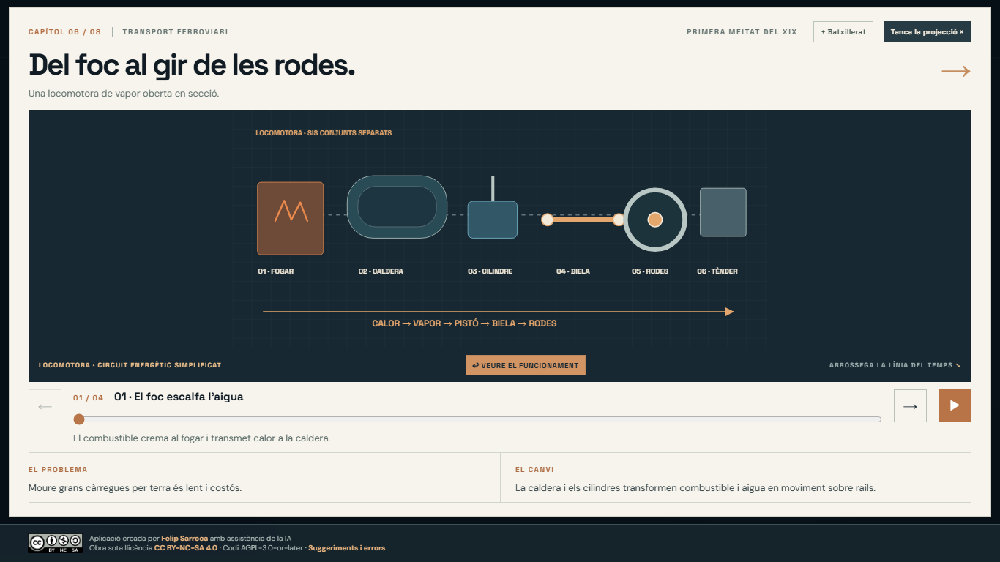
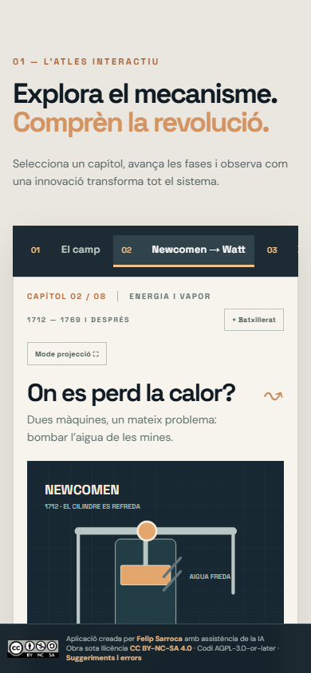

# La Revolució Industrial per dins

Atles interactiu en català per entendre **com funcionen** les innovacions de la industrialització. Creat per projectar a classe i per explorar-lo individualment a 4t d'ESO i a 1r de Batxillerat.

**Web publicada:** [ja.cat/revindustrial](https://ja.cat/revindustrial) · [Adreça directa de GitHub Pages](https://felipsarroca.github.io/web/RevolucioIndustrial/).

**Estat actual:** redisseny en curs. La portada i els vuit capítols ja tenen una primera implementació, però encara falta revisar-ne les il·lustracions, els textos i la visualització en diverses mides. Consulta [REDISSENY.md](REDISSENY.md) per veure què s'ha fet i què queda pendent. Les captures d'aquest README corresponen a la versió anterior.

## Obrir el web

Obre [`index.html`](index.html) al navegador. També el pots servir localment des d'aquesta carpeta:

```powershell
python -m http.server 4173
```

Després visita `http://localhost:4173/`. És un web estàtic: no requereix instal·lació, compte ni base de dades. Les tipografies de Google Fonts necessiten connexió; sense connexió es mostra una tipografia alternativa.

## Què s'hi pot fer

- Explorar **vuit capítols**: camp, Newcomen i Watt, tèxtil, fàbrica, metalls, locomotora, vaixell i capital.
- Avançar les fases de cada procés amb les fletxes, el control lliscant o la reproducció automàtica.
- Alternar entre l'explicació essencial i la capa d'anàlisi de **1r de Batxillerat**, amb una font pública per capítol.
- Obrir la **vista de peces** de les màquines de vapor, la locomotora i el vaixell.
- Fer servir el **mode projecció** per veure la màquina i els controls dins de la pantalla; `Esc` el tanca.
- Recórrer el **mapa del canvi** per passar d'un sistema a l'altre.

Els diagrames SVG són originals i explicatius. Mostren principis mecànics i fluxos; quan representen un model simplificat s'indica expressament. El [guió i la visió del projecte](VISIO-I-GUIO.md) documenten les decisions, les fonts del quadern i els passos següents.

## Captures

| Portada | Mode projecció |
|---|---|
|  |  |

| Vista de peces de la locomotora | Vista mòbil |
|---|---|
|  |  |

## Rigor i abast

L'arada normanda és un precedent medieval; el bloc agrari se centra en Norfolk, Jethro Tull i Rotherham. El convertidor de Bessemer (1856) i les formes de concentració com *trust* i *holding* se situen com a continuacions posteriors. El web se centra en tecnologia, producció i transport; el moviment obrer i les condicions de vida no en són capítols.

Les fonts públiques principals són el [Science Museum](https://blog.sciencemuseum.org.uk/james-watt-and-the-separate-condenser/), el [Science and Industry Museum](https://blog.scienceandindustrymuseum.org.uk/preserving-history-thanks/), el [National Railway Museum](https://www.railwaymuseum.org.uk/sites/default/files/2023-10/Pages%20from%20LOCOMOTION%20report%20part%201.pdf) i el [currículum català d'Història del Món Contemporani](https://xtec.gencat.cat/web/.content/curriculum/batxillerat/curriculum-171-2022/materies-de-modalitat/modalitat-humanitats-i-ciencies-socials/Historia-del-Mon-Contemporani.pdf). El quadern de NotebookLM «SOC4 - 3. Els orígens de la industrialització» ha servit per inventariar els materials existents. Les imatges del quadern no s'han republicat: cal comprovar-ne els drets abans de fer-ho.

## Estat del projecte

Aquesta és la **primera versió funcional, publicada el 13 de novembre de 2026**. Queden per desenvolupar il·lustracions tècniques més detallades i validades per a models històrics concrets, recorreguts interiors de fàbriques i transports, i comparacions de velocitat amb rutes i dates documentades. El guió enumera aquestes feines i els criteris de revisió.

La interfície s'ha comprovat al navegador a 1440 × 900, 1366 × 768 i 390 × 844, incloent-hi la navegació, les fases, la reproducció, el canvi de nivell, les vistes de peces i el mode projecció. Les proves de 125 % i 150 % d'escalat real del sistema operatiu queden pendents.

## Llicència i incidències

El codi és [GNU AGPLv3 o posterior](LICENSE); els textos, diagrames i il·lustracions originals són [CC BY-NC-SA 4.0](LICENSE). Les tipografies de Google Fonts conserven la seva llicència. Pots comunicar [suggeriments i errors](https://github.com/felipsarroca/web/issues/new?template=revolucio-industrial.yml).
