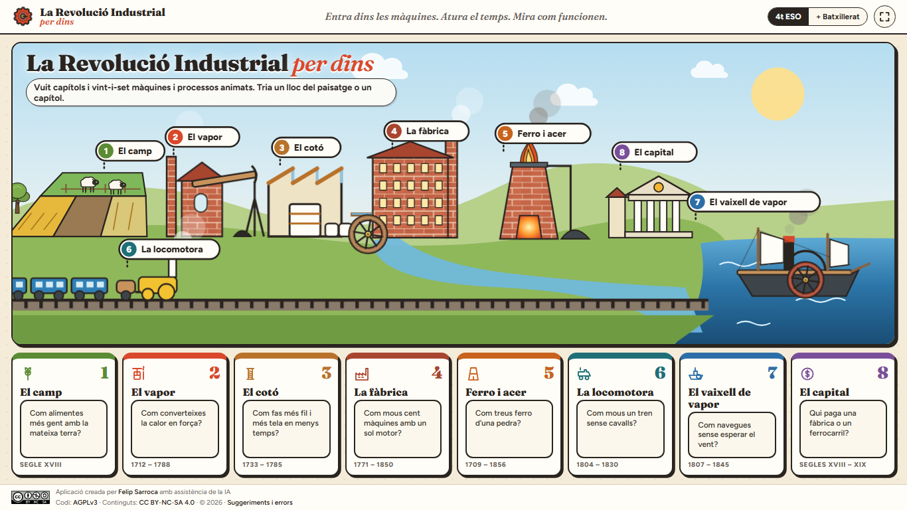
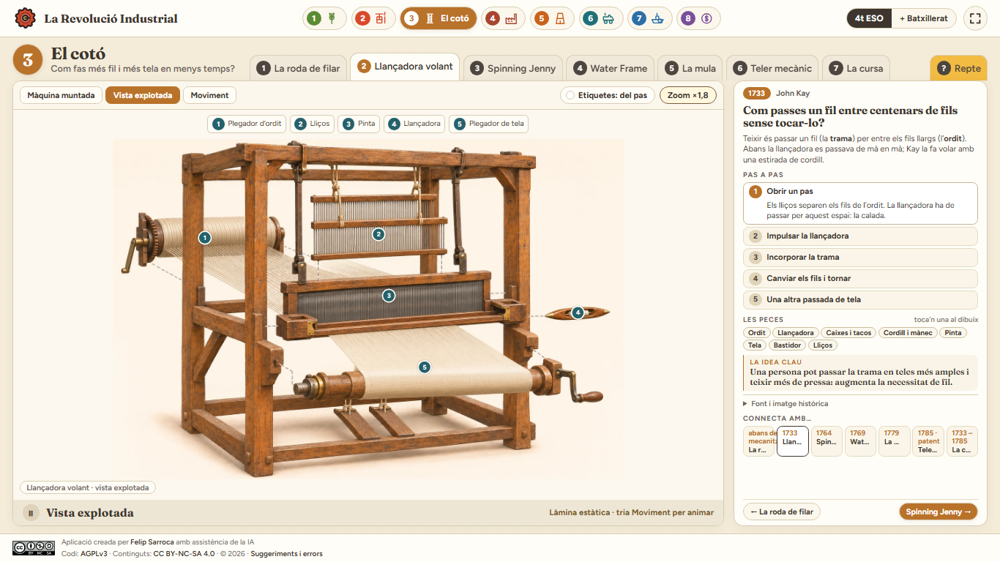
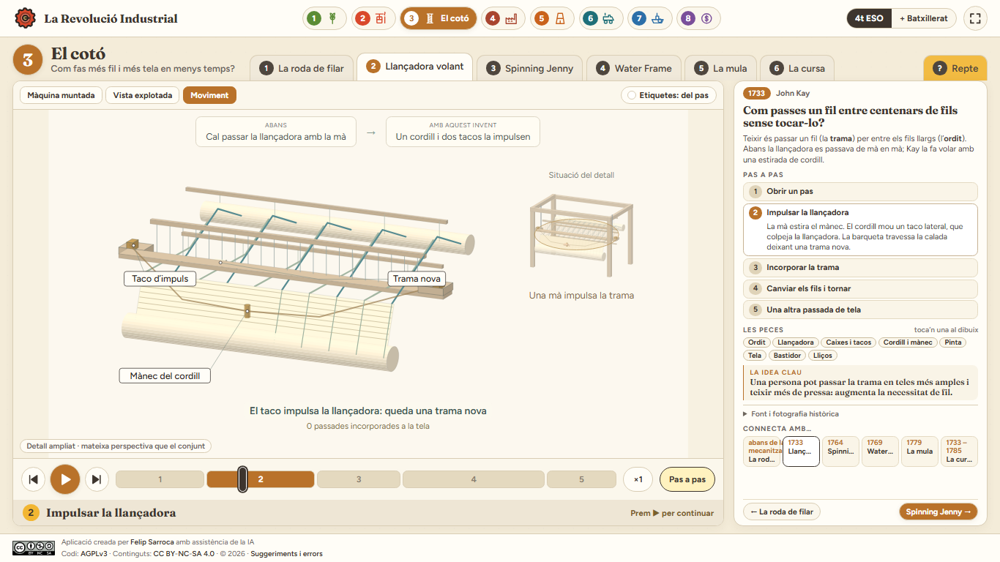
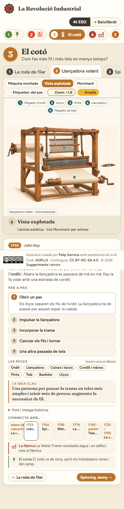
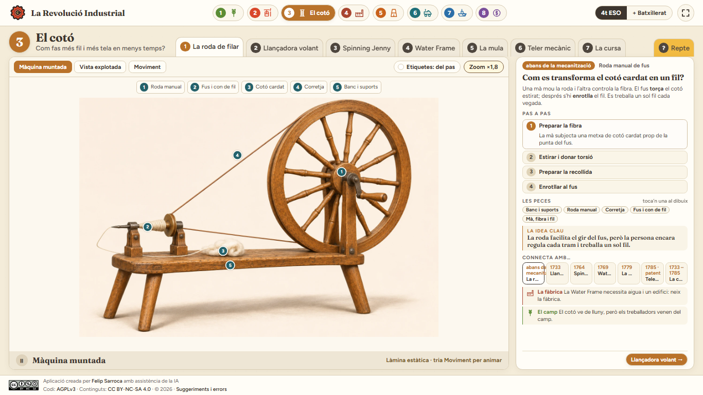
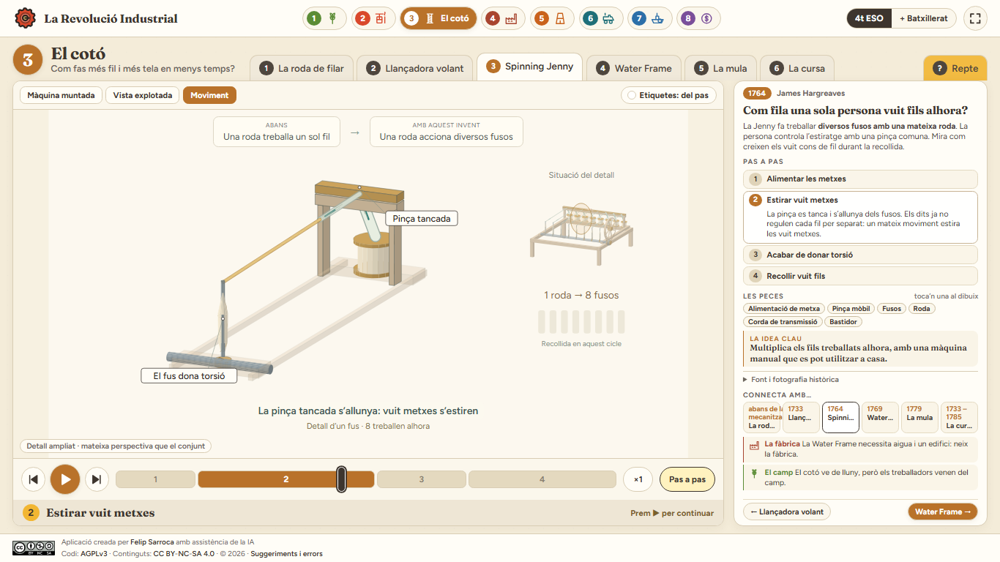
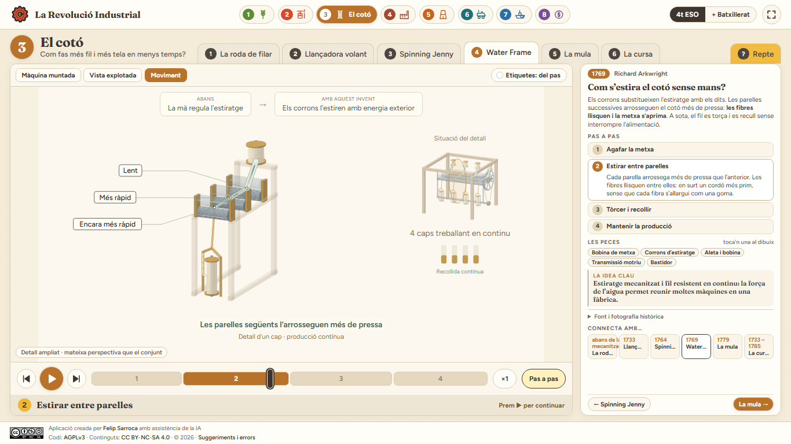

# La Revolució Industrial

Atles interactiu en català per entendre **com funcionen** les innovacions de la industrialització. Creat per projectar a classe i per explorar-lo individualment a 4t d'ESO i a 1r de Batxillerat.

**Web publicada:** [ja.cat/revindustrial](https://ja.cat/revindustrial) · [Adreça directa de GitHub Pages](https://felipsarroca.github.io/web/RevolucioIndustrial/).

**Estat actual:** vuit capítols, 27 escenes i tretze parelles de làmines muntades i explotades amb ChatGPT. El cotó inclou la roda de filar tradicional i cinc mecanismes animats amb una sola perspectiva obliqua. Consulta [REDISSENY.md](REDISSENY.md) per veure els criteris i les revisions.

**Revisió del cotó:** un detall funcional ampliat permet seguir un fil, amb el bastidor atenuat i una miniatura animada del conjunt des del mateix angle. La fibra solta és verdosa; el fil torçut, daurat; la trama, vermella. La síntesi relaciona problemes i innovacions sense inventar xifres de producció. Es conserven tant [la primera revisió](versions/2026-11-13-coto-primera-revisio/textil.html) com [la versió inicial](versions/2026-11-13-coto-abans-revisio/textil.html), cadascuna amb el codi, les imatges i les empremtes dels originals. La còpia inicial també inclou el restaurador.

## Obrir el web

Obre [`index.html`](index.html) al navegador. També el pots servir localment des d'aquesta carpeta:

```powershell
python -m http.server 4173
```

Després visita `http://localhost:4173/`. És un web estàtic: no requereix instal·lació, compte ni base de dades. Les tipografies de Google Fonts necessiten connexió; sense connexió es mostra una tipografia alternativa.

## Què s'hi pot fer

- Explorar **vuit capítols**: camp, Newcomen i Watt, tèxtil, fàbrica, metalls, locomotora, vaixell i capital.
- Avançar les fases de cada procés amb les fletxes, el control lliscant o la reproducció automàtica.
- Alternar entre l'explicació essencial i la capa d'anàlisi de **1r de Batxillerat**, amb una font pública per capítol.
- Obrir **Màquina muntada**, **Vista explotada** i **Moviment**. Les làmines indiquen entre tres i cinc conjunts principals amb punts numerats i fitxes clicables.
- Triar les etiquetes **del pas**, **totes** o **cap**, i tocar les peces per llegir-ne la funció.
- Seguir un sol fil en el detall ampliat de cada mecanisme tèxtil. Una miniatura sincronitzada mostra com treballa el conjunt amb la mateixa perspectiva; en mòbil es prioritza el detall.
- Consultar la fotografia històrica i la seva atribució en el desplegable de fonts.
- Fer servir **Amplia** en mòbil; `Esc` tanca la vista ampliada.

Els diagrames SVG són originals i explicatius. Mostren principis mecànics i fluxos; quan representen un model simplificat s'indica expressament. El [guió i la visió del projecte](VISIO-I-GUIO.md) documenten les decisions, les fonts del quadern i els passos següents.

## Captures

| Portada | Vista explotada del teler |
|---|---|
|  |  |

| Animació obliqua del teler | Vista mòbil |
|---|---|
|  |  |



| Un fus de la Jenny ampliat | Un cap de la Water Frame ampliat |
|---|---|
|  |  |

## Rigor i abast

L'arada normanda és un precedent medieval; el bloc agrari se centra en Norfolk, Jethro Tull i Rotherham. El convertidor de Bessemer (1856) i les formes de concentració com *trust* i *holding* se situen com a continuacions posteriors. El web se centra en tecnologia, producció i transport; el moviment obrer i les condicions de vida no en són capítols.

Les fonts públiques principals són el [Science Museum](https://blog.sciencemuseum.org.uk/james-watt-and-the-separate-condenser/), el [Science and Industry Museum](https://blog.scienceandindustrymuseum.org.uk/preserving-history-thanks/), el [National Railway Museum](https://www.railwaymuseum.org.uk/sites/default/files/2023-10/Pages%20from%20LOCOMOTION%20report%20part%201.pdf) i el [currículum català d'Història del Món Contemporani](https://xtec.gencat.cat/web/.content/curriculum/batxillerat/curriculum-171-2022/materies-de-modalitat/modalitat-humanitats-i-ciencies-socials/Historia-del-Mon-Contemporani.pdf). El quadern de NotebookLM «SOC4 - 3. Els orígens de la industrialització» ha servit per inventariar els materials existents. Les imatges del quadern no s'han republicat: cal comprovar-ne els drets abans de fer-ho.

## Estat del projecte

Aquesta és la **primera versió funcional, publicada el 13 de novembre de 2026**. Queden per desenvolupar il·lustracions tècniques més detallades i validades per a models històrics concrets, recorreguts interiors de fàbriques i transports, i comparacions de velocitat amb rutes i dates documentades. El guió enumera aquestes feines i els criteris de revisió.

La darrera comprovació ha recorregut les 27 escenes en cinc mides (135 combinacions), incloent-hi làmines, selecció de peces, zoom, etiquetes, fases dels mecanismes i reptes. Sense errors de JavaScript ni desbordaments detectats. Les captures mostren la versió actual.

Les fotografies històriques provenen de Wikimedia Commons i el desplegable de fonts n'indica l'autor i la llicència. El mapa de l'Atlàntic fa servir les costes de Natural Earth (domini públic). Les làmines són reconstruccions generades amb ChatGPT; les vistes explotades s'han editat a partir de les màquines muntades, conservant el model i l'orientació dels conjunts. Les mides són orientatives. Els prompts es conserven a `assets/prompts-illustracions.json`, `assets/prompts-explotades.json` i [prompts de la roda manual de fus](assets/prompts-coto-revisio.json).

Els cinc mecanismes tèxtils utilitzen una projecció obliqua comuna calculada a partir de geometria tridimensional, amb rotacions dins del pla de cada roda i desplaçaments del carro que conserven les correspondències entre fils. Són esquemes didàctics: els materials i els detalls es simplifiquen respecte de les làmines.

La roda tradicional representa una roda manual de fus del tipus *great wheel*, utilitzat també per al cotó, documentat al [Science Museum Group](https://collection.sciencemuseumgroup.org.uk/objects/co44851/great-wheel). La versió de Saxònia amb pedal i aleta es conserva a la carpeta anterior. La Water Frame representada té quatre caps de filatura i tres parelles de corrons; és una síntesi del principi, amb velocitats relatives il·lustratives. La data de 1769 identifica la invenció, no una reproducció exacta del prototip de patent. El [dossier de revisió](assets/revisio-coto.md) explica les fonts, les simplificacions i els límits.

La verificació visual inclou finestres de 1920 × 1080, 1366 × 768 i 390 × 844, i espais útils equivalents al 125 % i al 150 % d'escalat. L'escalat s'ha simulat al navegador; no s'ha canviat la configuració de Windows. Per repetir la comprovació, amb el servidor local actiu: `python assets/verifica_visual.py` (requereix Playwright i Chrome).

`node assets/verifica-cinematica.cjs` comprova 1.001 posicions del cicle i 105 geometries: marge de pas de la llançadora, direcció de la trama, temps de batuda, gir i alimentació dels corrons, aturada de la mula, rodament del carro, recollida, guies i continuïtat dels angles dins de cada cicle. També comprova la coherència entre projecció, profunditat i cares visibles. Els cons i els indicadors es reinicien en començar un nou cicle didàctic: no són comptadors acumulats de producció.

## Llicència i incidències

El codi és [GNU AGPLv3 o posterior](LICENSE); els textos, diagrames i il·lustracions originals són [CC BY-NC-SA 4.0](LICENSE). Les tipografies de Google Fonts conserven la seva llicència. Pots comunicar [suggeriments i errors](https://github.com/felipsarroca/web/issues/new?template=revolucio-industrial.yml).
