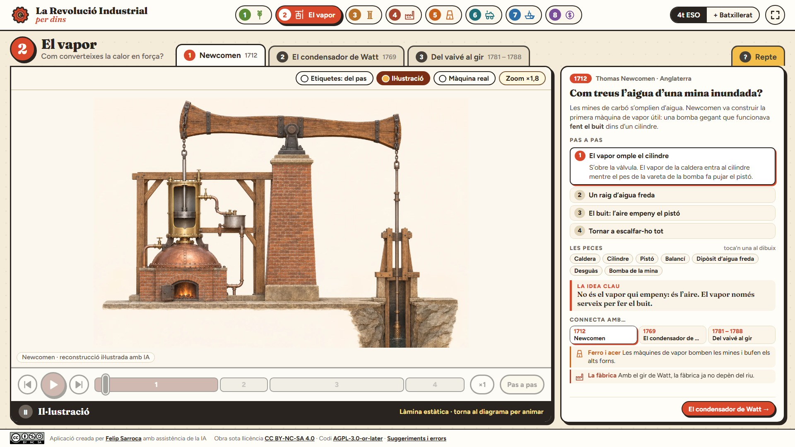
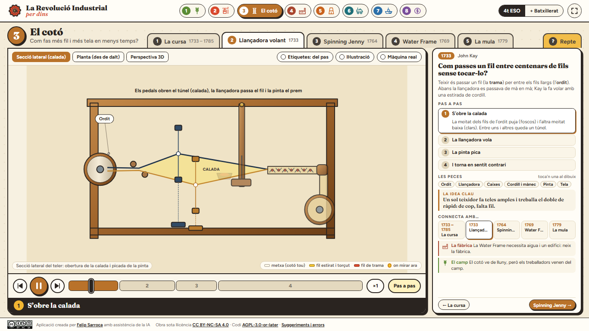

# La Revolució Industrial per dins

Atles interactiu en català per entendre **com funcionen** les innovacions de la industrialització. Creat per projectar a classe i per explorar-lo individualment a 4t d'ESO i a 1r de Batxillerat.

**Web publicada:** [ja.cat/revindustrial](https://ja.cat/revindustrial) · [Adreça directa de GitHub Pages](https://felipsarroca.github.io/web/RevolucioIndustrial/).

**Estat actual:** vuit capítols amb esquemes animats, fotografies històriques i dotze reconstruccions il·lustrades amb ChatGPT. Les etiquetes apareixen per fases per evitar la saturació visual. Consulta [REDISSENY.md](REDISSENY.md) per veure els criteris i la feina pendent.

## Obrir el web

Obre [`index.html`](index.html) al navegador. També el pots servir localment des d'aquesta carpeta:

```powershell
python -m http.server 4173
```

Després visita `http://localhost:4173/`. És un web estàtic: no requereix instal·lació, compte ni base de dades. Les tipografies de Google Fonts necessiten connexió; sense connexió es mostra una tipografia alternativa.

## Què s'hi pot fer

- Explorar **vuit capítols**: camp, Newcomen i Watt, tèxtil, fàbrica, metalls, locomotora, vaixell i capital.
- Avançar les fases de cada procés amb les fletxes, el control lliscant o la reproducció automàtica.
- Alternar entre l'explicació essencial i la capa d'anàlisi de **1r de Batxillerat**, amb una font pública per capítol.
- Obrir **Il·lustració** per veure la màquina completa amb materials i volum, i **Màquina real** per consultar la fotografia o el gravat històric.
- Triar les etiquetes **del pas**, **totes** o **cap**, i tocar les peces per llegir-ne la funció.
- Explorar seccions, plantes i perspectives quan l'escena disposa de diversos punts de vista.
- Fer servir **Amplia** en mòbil; `Esc` tanca la vista ampliada.

Els diagrames SVG són originals i explicatius. Mostren principis mecànics i fluxos; quan representen un model simplificat s'indica expressament. El [guió i la visió del projecte](VISIO-I-GUIO.md) documenten les decisions, les fonts del quadern i els passos següents.

## Captures

| Portada | Esquema animat amb etiquetes del pas |
|---|---|
|  |  |

| Reconstrucció il·lustrada amb ChatGPT | Vista mòbil |
|---|---|
|  |  |



## Rigor i abast

L'arada normanda és un precedent medieval; el bloc agrari se centra en Norfolk, Jethro Tull i Rotherham. El convertidor de Bessemer (1856) i les formes de concentració com *trust* i *holding* se situen com a continuacions posteriors. El web se centra en tecnologia, producció i transport; el moviment obrer i les condicions de vida no en són capítols.

Les fonts públiques principals són el [Science Museum](https://blog.sciencemuseum.org.uk/james-watt-and-the-separate-condenser/), el [Science and Industry Museum](https://blog.scienceandindustrymuseum.org.uk/preserving-history-thanks/), el [National Railway Museum](https://www.railwaymuseum.org.uk/sites/default/files/2023-10/Pages%20from%20LOCOMOTION%20report%20part%201.pdf) i el [currículum català d'Història del Món Contemporani](https://xtec.gencat.cat/web/.content/curriculum/batxillerat/curriculum-171-2022/materies-de-modalitat/modalitat-humanitats-i-ciencies-socials/Historia-del-Mon-Contemporani.pdf). El quadern de NotebookLM «SOC4 - 3. Els orígens de la industrialització» ha servit per inventariar els materials existents. Les imatges del quadern no s'han republicat: cal comprovar-ne els drets abans de fer-ho.

## Estat del projecte

Aquesta és la **primera versió funcional, publicada el 13 de novembre de 2026**. Queden per desenvolupar il·lustracions tècniques més detallades i validades per a models històrics concrets, recorreguts interiors de fàbriques i transports, i comparacions de velocitat amb rutes i dates documentades. El guió enumera aquestes feines i els criteris de revisió.

La darrera comprovació ha recorregut les 26 escenes en cinc mides (130 combinacions), incloent-hi canvis de vista, etiquetes, làmines i reptes. Sense errors de JavaScript ni desbordaments detectats. Les captures mostren la versió actual.

Les fotografies de «Màquina real» provenen de Wikimedia Commons i cada cartela n'indica l'autor i la llicència. El mapa de l'Atlàntic fa servir les costes de Natural Earth (domini públic). Les reconstruccions de «Il·lustració» són imatges generades amb ChatGPT, amb proporcions orientatives: serveixen per reconèixer el conjunt. El funcionament s'estudia amb l'esquema animat. Els prompts es conserven a `assets/prompts-illustracions.json`.

La verificació visual inclou finestres de 1920 × 1080, 1366 × 768 i 390 × 844, i espais útils equivalents al 125 % i al 150 % d'escalat. L'escalat s'ha simulat al navegador; no s'ha canviat la configuració de Windows. Per repetir la comprovació, amb el servidor local actiu: `python assets/verifica_visual.py` (requereix Playwright i Chrome).

## Llicència i incidències

El codi és [GNU AGPLv3 o posterior](LICENSE); els textos, diagrames i il·lustracions originals són [CC BY-NC-SA 4.0](LICENSE). Les tipografies de Google Fonts conserven la seva llicència. Pots comunicar [suggeriments i errors](https://github.com/felipsarroca/web/issues/new?template=revolucio-industrial.yml).
