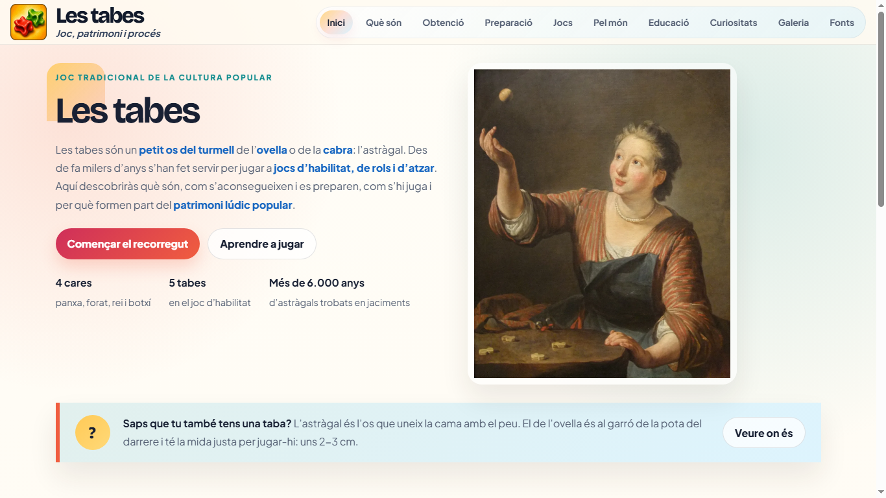
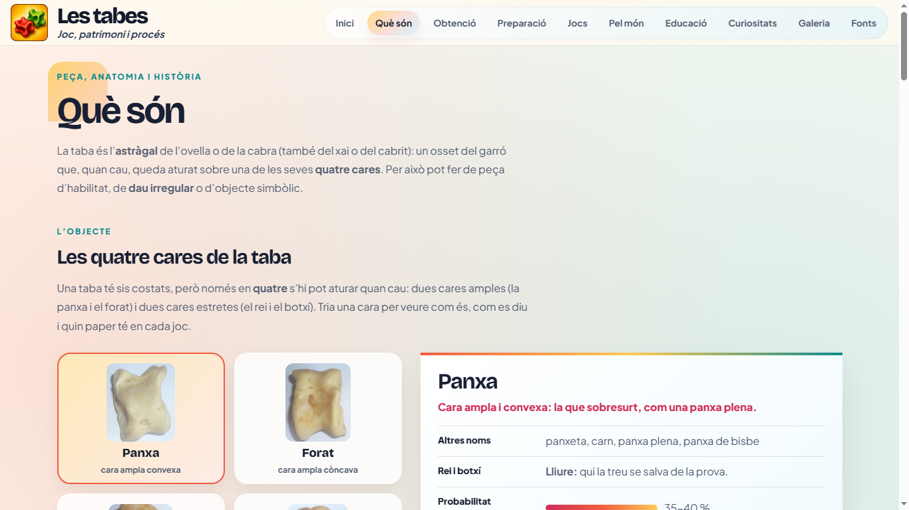
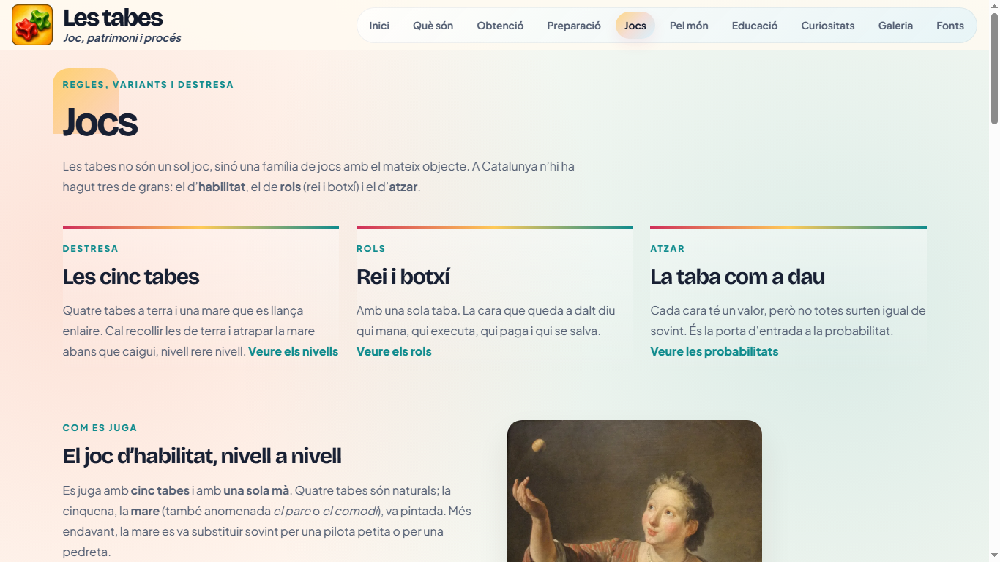
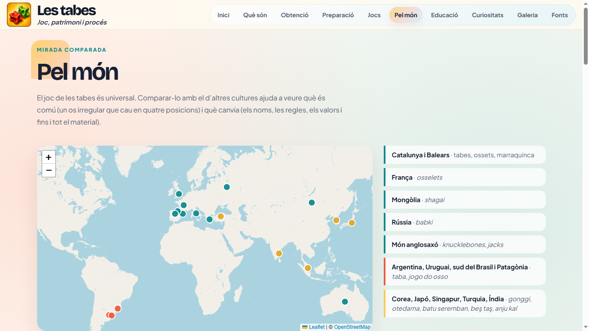
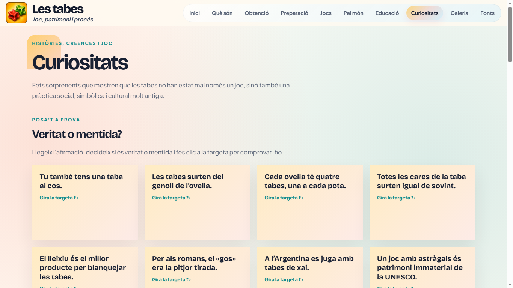
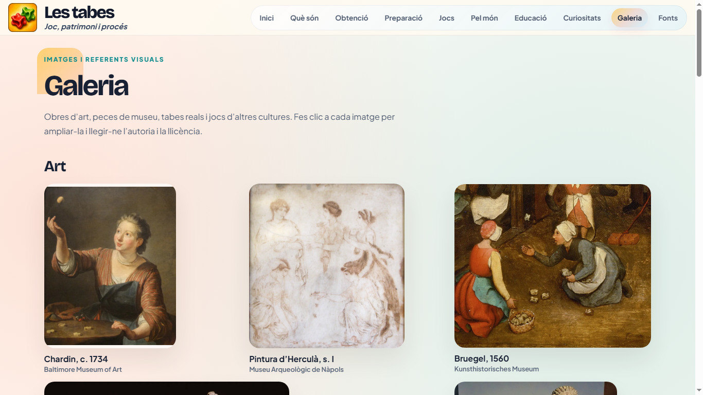

# Les tabes

Web didàctica en HTML, CSS i JavaScript sobre les tabes, els astràgals d'ovella i de cabra. Explica què són, com s'obtenen i es preparen, com s'hi juga aquí i arreu del món, i com es poden aprofitar a l'aula.

## Pàgines

| Pàgina | Contingut |
|---|---|
| `index.html` | Portada i recorregut per tota la web |
| `que-son.html` | Explorador de les quatre cares, anatomia comparada, mapa dels noms i cronologia |
| `obtencio.html` | Com demanar els astràgals a la carnisseria |
| `preparacio.html` | Sis passos per netejar, blanquejar i decorar les tabes, amb mesures de seguretat |
| `jocs.html` | Joc d'habilitat il·lustrat nivell a nivell, rei i botxí, joc d'atzar i variants locals |
| `mon.html` | Mapa mundial: shagai, osselets, taba criolla, babki, gonggi i otedama |
| `educacio.html` | Propostes per matèries i laboratori de probabilitat (simulador i registre de classe) |
| `curiositats.html` | Targetes «Veritat o mentida?» i històries antigues amb la seva font |
| `galeria.html` | Imatges agrupades per temes, amb autoria i llicència |
| `fonts.html` | Fonts clàssiques, diccionaris, institucions i crèdits de les imatges |

## Característiques

- Disseny adaptat a mòbil, tauleta, portàtil (1366 × 768 i escalat del 125-150 %) i pantalla gran.
- Mapes interactius amb Leaflet i OpenStreetMap.
- Simulador de probabilitat amb valors orientatius: panxa 40 %, forat 38 %, rei 11 % i botxí 11 %.
- Les imatges generades amb IA porten l'etiqueta «Recreació feta amb IA».

## Captures de pantalla

### Inici

### Què són

### Jocs

### Pel món

### Curiositats

### Galeria

